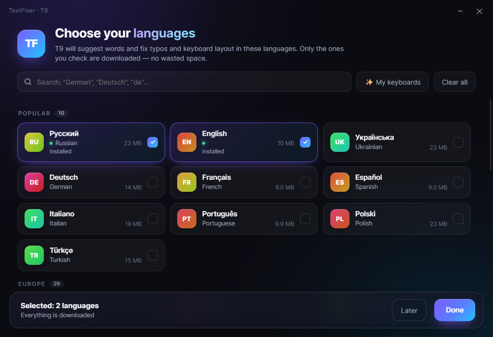

# TextFixer

Hotkey text correction powered by Gemini, plus a smart **iPhone-style T9** that works in **any
Windows app** — in **49 languages** (every European language and popular Latin-script ones).



## Features

- ⌨️ **`Ctrl+Alt+C` — fix the selection** (or the whole text field) with Gemini: spelling,
  punctuation, accidental Caps Lock, words typed together. Takes about 0.5 s and keeps your
  style and slang.
- 📱 **T9 (`Ctrl+Alt+T`)** — fully offline, in any program:
  - 3 context-aware suggestions next to the caret: `Tab` inserts, `Shift+Tab` picks another,
    `Esc` hides; after a space it predicts the next word;
  - autocorrect on space / punctuation / Enter (`recieve` → `receive`, `zolty` → `żółty`,
    `карова` → `корова`); press `Backspace` right after a correction to undo it — the word is remembered;
  - wrong keyboard layout fix (`ghbdtn` → `привет`) between **any** installed layouts, and the
    window's layout is switched automatically;
  - auto-commas (ru, uk, pl, cs, sk, de), sentence capitalization, capitalized names and German
    nouns, double space → period, `dont` → `don't`, `i` → `I`;
  - turns off an accidental Caps Lock (`HELLO THERE` typed with Caps on → `hello there`);
  - learns your vocabulary (`user_dict.json`, stored only on your PC).
- 🔤 **`Ctrl+Alt+L`** — convert the keyboard layout of the selected text.
- 🙈 All TextFixer windows are hidden from screen capture.
- 🌍 Interface in English and Russian (picked automatically from the Windows language,
  or set `"ui_language": "en"` / `"ru"` in `config.json`).

## Installation

1. You need **Windows 10/11** and **[Python 3.10+](https://www.python.org/downloads/)**
   (tick *Add python.exe to PATH* in the installer).
2. Download this repository (**Code → Download ZIP**) and unzip it.
3. Run **`Start.bat`**. The first time it installs everything it needs (about a minute) and
   opens the language picker — only the dictionaries you check are downloaded (5–25 MB each).
4. `Ctrl+Alt+C` needs a free [Google AI Studio](https://aistudio.google.com/apikey) API key —
   the app will ask for it. T9 works without a key.

The tray icon has: T9 on/off, **"T9 languages…"** (add or remove languages), T9 settings and
"Start with Windows". `Debug.bat` runs the app with a console window (shows logs).

## Languages

**Popular:** Russian, English, Ukrainian, German, French, Spanish, Italian, Portuguese, Polish, Turkish.
**Europe:** Dutch, Czech, Slovak, Hungarian, Romanian, Bulgarian, Greek, Swedish, Danish, Norwegian,
Finnish, Estonian, Latvian, Lithuanian, Slovenian, Croatian, Serbian, Bosnian, Macedonian, Albanian,
Belarusian, Irish, Welsh, Icelandic, Maltese, Catalan, Basque, Galician, Luxembourgish.
**Latin script worldwide:** Indonesian, Malay, Vietnamese, Filipino, Swahili, Azerbaijani, Uzbek,
Afrikaans, Esperanto, Latin.

T9 detects the language of each word from the window's keyboard layout and the recent words
(German typed on an English layout is recognized too). 8 languages (fi, be, mt, ms, tl, az, uz, eu)
have no complete open spelling dictionary — there, frequent words count as correct and corrections
are more cautious ("basic" mode).

## Quality

Measured on held-out sentences that were not used to build the dictionaries. Synthetic typos
(neighbouring key, missing/extra letter, swapped letters, missing diacritics) are fixed correctly in
**92–98%** of cases across all 49 languages. T9 rarely touches correct words — usually
**0.1–1.5%** (Russian 0.2%, English 0.5%, German 0.8%, French 0.2%).
Check a language yourself: `python tools/eval_lang.py <lang> <holdout.txt>`.

## Privacy

- T9 is fully **offline**; nothing you type is sent anywhere.
- `Ctrl+Alt+C` and the optional "cloud phrases" send text to Google Gemini.
- The API key lives in `config.json` and learned words in `user_dict.json`; both are git-ignored.

## For developers

```
textfixer/
  app.py         tray, hotkeys, wiring            setup_ui.py  language picker (WebView2)
  t9.py          keyboard hook, suggestions       ui/setup.html  picker interface
  engine.py      dictionaries, autocorrect        dicts.py     dictionary downloads
  languages.py   49 languages, layouts, DICT_REPO gemini.py    cloud correction
  i18n.py        interface strings (en, ru)
tools/
  find_sources.py    find a Hunspell dictionary + corpus per language -> sources.json
  build_all.py       download sources and build every dictionary -> dist/dicts + manifest.json
  build_dicts.py     build one language
  eval_lang.py       measure quality on held-out sentences
  publish_dicts.ps1  upload the dictionaries to a GitHub Release
  make_notices.py    generate THIRD_PARTY_NOTICES.md
```

Building and publishing the dictionaries:

```
pip install -r tools/requirements-build.txt
python tools/build_all.py --cache D:/t9cache          # ~10 GB of sources, 1–2 hours
python tools/make_notices.py
powershell -ExecutionPolicy Bypass -File tools/publish_dicts.ps1 -Repo <user>/TextFixer
```

Then set `DICT_REPO = "<user>/TextFixer"` in `textfixer/languages.py`.
To test without GitHub, put `"dict_source": "C:/path/to/dist/dicts"` into `config.json`.

Adding an interface language: add a dictionary to `STRINGS` in `textfixer/i18n.py`.

## License

The code is MIT (`LICENSE`). The dictionaries follow the licenses of their sources —
see [THIRD_PARTY_NOTICES.md](THIRD_PARTY_NOTICES.md).
